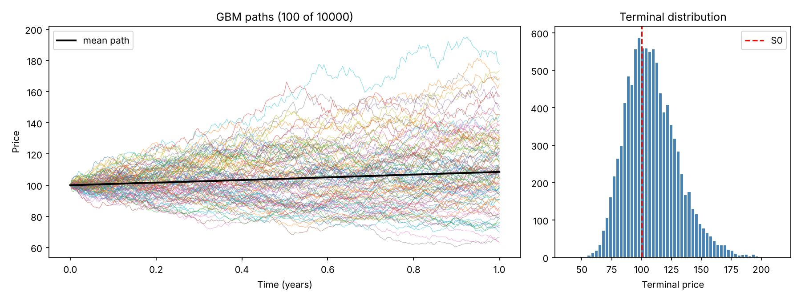

# monte-carlo-simulator

Quantitative stock price simulator using Monte Carlo and Geometric Brownian Motion (GBM), with risk metrics and European option pricing validated against Black-Scholes.



## Model

Under GBM the price follows dS = μS dt + σS dW, which has the exact solution

```
S(t+Δt) = S(t) · exp((μ − σ²/2)Δt + σ√Δt · Z),   Z ~ N(0,1)
```

Paths are simulated in log space using this exact step, so there is no discretisation error. The −σ²/2 term (Itô correction) ensures E[S_T] = S₀e^{μT}.

## Features

- Vectorised NumPy path simulation, seeded and reproducible
- Antithetic variates for variance reduction
- Terminal-price statistics, probability of profit, VaR and CVaR
- Parameter estimation (μ, σ) from a historical price CSV
- European call/put pricing by Monte Carlo with standard errors, compared against the Black-Scholes closed form
- Test suite checking convergence to theoretical moments and option prices

## Usage

```bash
pip install -r requirements.txt

# Simulate with given parameters
python simulate.py --s0 100 --mu 0.08 --sigma 0.2 --T 1 --paths 10000 --plot paths.png

# Estimate mu and sigma from historical prices (last numeric column, e.g. Close)
python simulate.py --csv prices.csv --T 0.5 --plot paths.png

# Also price European options at strike 105
python simulate.py --s0 100 --sigma 0.2 --r 0.05 --T 1 --strike 105
```

Example output:

```
S0=100.00  mu=0.0800  sigma=0.2000  T=1.0  paths=10000
Theoretical E[S_T]   : 108.3287
mean                 : 108.5231
median               : 106.2738
prob_profit          : 61.84%
VaR (95%)            : 23.50%
CVaR (95%)           : 29.00%

European options  K=105.0  r=0.05
  call: MC 8.0369 ± 0.0653 (95% CI) | Black-Scholes 8.0214
  put : MC 7.9054 ± 0.0418 (95% CI) | Black-Scholes 7.9004
```

## Tests

```bash
python -m pytest -q
```

Tests verify that the simulated mean and log-variance converge to their theoretical values, that Monte Carlo option prices fall within 4 standard errors of Black-Scholes, put-call parity, a known textbook value (Hull), and parameter recovery from simulated data.

## Limitations

GBM assumes constant volatility and log-normal returns, so it understates fat tails and volatility clustering seen in real markets. Drift estimates from historical data are very noisy (standard error ≈ σ/√T), so μ should be treated as an assumption rather than a forecast.
